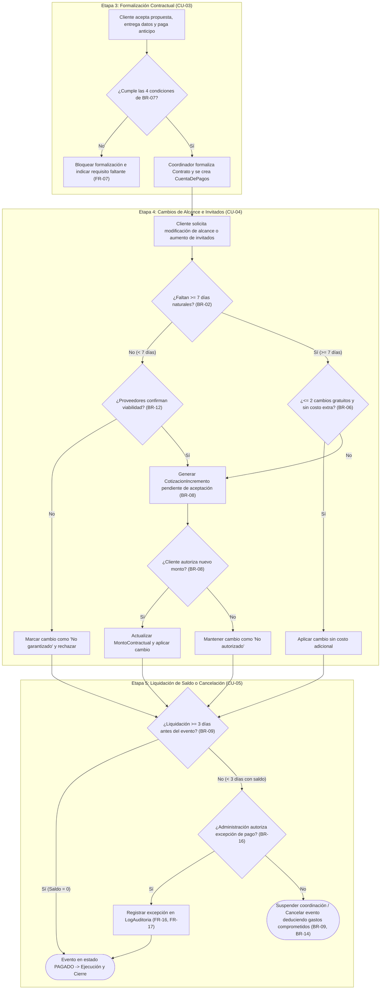

# Modelo de Procesos de Negocio (BPMN) — Caso Eventos Nova

**Universidad Autónoma de Nuevo León (UANL) · FIME**  
**Unidad 2 y PIA · Equipo 16**  
**Diagrama BPMN original en PDF:** [`BPMN_Final.pdf`](BPMN_Final.pdf)

---

## 1. Subproceso 1: Cotización y Asignación Preliminar de Proveedores (Etapas 1 y 2)

Carriles (*Swimlanes*) participantes: **Cliente**, **Coordinador**, **Proveedor**.

```mermaid
flowchart LR
    subgraph Cliente
        C1(["Inicio: Solicita cotización"]) --> C2["Indica fecha, tipo de evento y número estimado de invitados"]
        C3["Recibe propuesta y cotización"] --> C4(["Fin: Continúa en Contratación"])
    end

    subgraph Coordinador
        K1["Recibir y registrar solicitud"] --> K2{"¿Anticipación >= 15 días? (BR-01)"}
        K2 -- "No (< 15 días)" --> K3["Alertar: disponibilidad no garantizada (FR-01)"]
        K2 -- "Sí (>= 15 días)" --> K4["Registrar solicitud y continuar"]
        K3 --> K4
        K4 --> K5{"¿Invitados > 300? (BR-05)"}
        K5 -- "Sí (> 300)" --> K6["Evaluación especial de capacidad y proveedores"]
        K5 -- "No (20 a 300)" --> K7["Continuar con flujo normal"]
        K6 --> K8["Preparar propuesta preliminar e identificar proveedores"]
        K7 --> K8
        K8 --> K9{"¿Proveedores asignados = 15? (BR-15)"}
        K9 -- "Sí (= 15)" --> K10["Solicitar autorización especial para exceder límite"]
        K9 -- "No (< 15)" --> K11["Solicitar disponibilidad, precio y condiciones al proveedor"]
        K11 --> K12["Esperar / recibir respuesta del proveedor"]
        K12 --> K13{"¿Respondió dentro de 48 h? (BR-04)"}
        K13 -- "No (> 48 h)" --> K14["Marcar proveedor 'Sin confirmar' y notificar"]
        K13 -- "Sí (<= 48 h)" --> K15{"¿Disponible y acepta condiciones?"}
        K14 --> K16["Buscar proveedor alternativo (BR-10 / BR-13)"]
        K15 -- "No" --> K16
        K16 --> K11
        K15 -- "Sí" --> K17["Registrar confirmación del proveedor"]
        K17 --> K18{"¿Quedan más proveedores por asignar?"}
        K18 -- "Sí" --> K9
        K18 -- "No" --> K19["Consolidar proveedores y enviar cotización al cliente"]
    end

    subgraph Proveedor
        P1["Evaluar y responder disponibilidad, precio y condiciones (máx. 48 h - BR-04)"]
    end

    C2 --> K1
    K11 --> P1
    P1 --> K12
    K19 --> C3
```

---

## 2. Subproceso 2: Formalización de Contrato, Cambios de Alcance y Liquidación (Etapas 3, 4 y 5)

Carriles (*Swimlanes*) participantes: **Cliente**, **Coordinador**, **Administración**.

