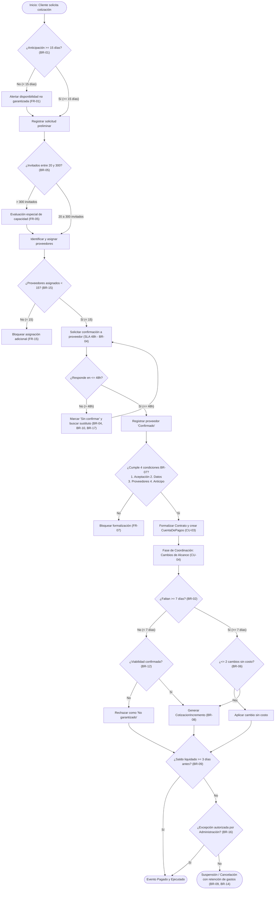

# Documento de Requerimientos de Negocio (BRD) — Caso Eventos Nova

**Universidad Autónoma de Nuevo León (UANL) · Facultad de Ingeniería Mecánica y Eléctrica (FIME)**  
**Materia:** Componentes de Lógica de Negocios — Producto Integrador de Aprendizaje (PIA)  
**Equipo 16:**
- Oscar Felipe Renaut Vega (2226683)
- Diana Lucía Hernández Fraire (2226678)
- José Tadeo Cruz Bazaldúa (2226710)

> **Documentos fuente originales en PDF incluidos en esta carpeta (`docs/`):**
> - [`BRD2_EventosNova_final.pdf`](BRD2_EventosNova_final.pdf) — Documento de Requerimientos de Negocio consolidado.
> - [`User_Stories_final.pdf`](User_Stories_final.pdf) / [`User_Stories.md`](User_Stories.md) — 18 Historias de Usuario con nivel de importancia y criterios en Gherkin.
> - [`BPMN_Final.pdf`](BPMN_Final.pdf) / [`BPMN.md`](BPMN.md) — Modelado BPMN del proceso de negocio.
> - [`Glosario_Dominio_Eventos_Nova.pdf`](Glosario_Dominio_Eventos_Nova.pdf) / [`Glosario_Dominio.md`](Glosario_Dominio.md) — Glosario de Dominio (35 términos en 6 familias).

---

## Contenido

1. [Contexto y modelo de negocio](#1-contexto-y-modelo-de-negocio)
2. [Problema y oportunidad de mejora](#2-problema-y-oportunidad-de-mejora)
3. [Propósito y objetivo del documento](#3-propósito-y-objetivo-del-documento)
4. [Objetivos de negocio](#4-objetivos-de-negocio)
5. [Necesidades del negocio (BN-01 a BN-14)](#5-necesidades-del-negocio)
6. [Alcance del proyecto](#6-alcance-del-proyecto)
7. [Stakeholders y roles del proceso](#7-stakeholders-y-roles-del-proceso)
8. [Descripción general del proceso de negocio (AS-IS) y BPMN](#8-descripción-general-del-proceso-de-negocio-as-is-y-bpmn)
9. [Reglas de negocio (BR-01 a BR-17)](#9-reglas-de-negocio)
10. [Requerimientos funcionales (FR-01 a FR-18)](#10-requerimientos-funcionales)
11. [Requerimientos no funcionales (NFR-01 a NFR-05)](#11-requerimientos-no-funcionales)
12. [Requerimientos de información (datos)](#12-requerimientos-de-información-datos)
13. [Reportes e indicadores de negocio](#13-reportes-e-indicadores-de-negocio)
14. [Criterios de éxito](#14-criterios-de-éxito)
15. [Supuestos y restricciones](#15-supuestos-y-restricciones)
16. [Validación y matriz de trazabilidad del análisis](#16-validación-y-trazabilidad)
17. [Glosario de Dominio (Lenguaje Ubicuo — 35 términos)](#17-glosario-de-dominio-lenguaje-ubicuo)
18. [Catálogo Completo de User Stories con Criterios Gherkin (US-01 a US-18)](#18-catálogo-completo-de-user-stories-con-criterios-gherkin)

---

## 1. Contexto y modelo de negocio

**Eventos Nova** es una empresa dedicada a la organización de bodas, graduaciones y eventos empresariales. Sus ingresos provienen de la coordinación y contratación de servicios con proveedores externos (salón, alimentos, mobiliario, música, decoración, fotografía, entre otros). El proceso central del negocio comprende cuatro grandes etapas: **cotización, contratación, coordinación y ejecución del evento**.

### 1.1 Operación actual (AS-IS)
De acuerdo con la descripción del caso y con lo confirmado por el stakeholder, la operación actual sigue el siguiente flujo de trabajo: el cliente proporciona la fecha del evento, el número estimado de asistentes y el tipo de evento; un coordinador gestiona y consulta con los proveedores necesarios (salón, alimentos, mobiliario, música, decoración y fotografía) para verificar su disponibilidad y condiciones preliminares, preparando con base en ello una propuesta y cotización formal. Una vez que la propuesta es aceptada por el cliente, se recopila la información requerida del evento, se confirman los servicios y el cliente efectúa el pago del anticipo correspondiente; con estas cuatro condiciones cubiertas, se formaliza el contrato del evento. Posteriormente, durante la fase de coordinación, se atienden cambios, se ratifican servicios y se realiza la confirmación definitiva de invitados previa a la liquidación del saldo y ejecución del evento.

Este documento consolida el levantamiento de requerimientos de negocio realizado para el caso Eventos Nova, a partir de tres fuentes:
1. La descripción del caso proporcionada (contexto, operación AS-IS, actores, excepciones conocidas y problemas observados).
2. La entrevista simulada aplicada al stakeholder del negocio, compuesta por 19 preguntas que cubren plazos, reglas, roles, datos y reportes.
3. Las 18 historias de usuario (*user stories*) con sus criterios de aceptación en notación Gherkin, elaboradas a partir de dichas respuestas.

### 1.2 Actores que participan
* **Cliente**
* **Coordinador**
* **Proveedor**
* **Administración**

---

## 2. Problema y oportunidad de mejora

El caso identifica un conjunto de situaciones especiales que la operación actual ya reconoce como parte del negocio, pero que hoy se resuelven de forma manual y sin un control sistemático:
* Cancelación de un proveedor ya confirmado.
* Aumento en el número de invitados después de confirmado.
* Cambio de horario o de menú.
* Solicitud de un servicio adicional.
* Saldo pendiente de pago.
* Cambios solicitados después de la fecha límite establecida.

Adicionalmente, se observan los siguientes problemas en la forma en que se opera actualmente el proceso, mismos que constituyen el problema de negocio a resolver:
* Los cambios comunicados por WhatsApp no llegan de forma consistente a todos los involucrados (cliente, coordinador, proveedores).
* Existen versiones distintas de la propuesta circulando entre las partes, sin una fuente única de verdad.
* Los proveedores en ocasiones reciben información desactualizada del evento (fecha, invitados, servicios).
* Existe dificultad para controlar qué costos y qué cambios han sido efectivamente autorizados.

**Oportunidad de mejora:** Automatizar y centralizar el control de cotizaciones, cambios, proveedores y pagos permitirá a Eventos Nova mantener una única versión vigente de cada propuesta y contrato, garantizar que los cambios autorizados se reflejen de forma consistente para todas las partes, dar seguimiento oportuno a los plazos críticos del negocio (anticipación de cotización, confirmación de invitados, confirmación de proveedores, liquidación de saldo) y contar con visibilidad gerencial mediante reportes e indicadores, reduciendo así el riesgo operativo y financiero descrito por el stakeholder.

---

## 3. Propósito y objetivo del documento

El propósito de este Documento de Requerimientos de Negocio (*Business Requirements Document*, BRD) es establecer una fuente única y formal de los requerimientos de negocio del caso Eventos Nova, que sirva como base para el diseño, desarrollo y validación de la solución. Este documento busca:
* Formalizar las reglas de negocio identificadas en la entrevista al stakeholder.
* Traducir las user stories y sus criterios de aceptación en requerimientos funcionales trazables.
* Definir los roles del proceso y sus niveles de autorización.
* Especificar la información que el sistema debe capturar, consultar y actualizar.
* Establecer los reportes e indicadores que el negocio requiere para su seguimiento operativo.
* Servir como base de validación entre el equipo de análisis, el stakeholder y el equipo de desarrollo.

---

## 4. Objetivos de negocio

A partir de las respuestas del stakeholder se identifican los siguientes objetivos que la solución debe apoyar:
* Garantizar la disponibilidad de fechas y proveedores mediante el control de tiempos mínimos de anticipación para cotizar, modificar y cancelar eventos.
* Reducir el riesgo financiero de Nova controlando los plazos de pago del anticipo y del saldo, así como las condiciones para formalizar un contrato.
* Mantener actualizada la cotización y el monto contractual ante cualquier cambio que impacte el costo del evento, asegurando la autorización del cliente.
* Asegurar la continuidad operativa del evento ante cancelaciones o cambios de condiciones por parte de los proveedores.
* Delimitar claramente las responsabilidades y autorizaciones de cliente, coordinador y administración.
* Proveer visibilidad gerencial del negocio mediante reportes e indicadores de eventos, pagos, proveedores y cumplimiento de plazos.

---

## 5. Necesidades del negocio

Las siguientes necesidades (`BN`) traducen el problema de negocio y los objetivos en planteamientos concretos que la solución debe satisfacer:

| ID | Necesidad del negocio | US relacionadas |
| :--- | :--- | :--- |
| **BN-01** | Garantizar que las cotizaciones se soliciten con anticipación suficiente para asegurar disponibilidad de fecha y proveedores. | US-01 |
| **BN-02** | Controlar y limitar los cambios solicitados por el cliente antes y después de la fecha límite, evitando versiones inconsistentes de la propuesta (problema de cambios por WhatsApp). | US-02, US-06, US-12 |
| **BN-03** | Asegurar que el número final de invitados quede confirmado a tiempo para ajustar los servicios contratados por cantidad. | US-03, US-11 |
| **BN-04** | Asegurar que los proveedores confirmen oportunamente disponibilidad, precio y condiciones, evitando que operen con información desactualizada. | US-04, US-13 |
| **BN-05** | Identificar oportunamente cuándo un evento excede la capacidad estándar de atención del negocio. | US-05 |
| **BN-06** | Formalizar contratos únicamente cuando el cliente cumpla todas las condiciones establecidas, evitando compromisos sin respaldo. | US-07 |
| **BN-07** | Mantener actualizado el costo del evento y obtener autorización del cliente ante cualquier cambio que lo modifique, para controlar costos y cambios autorizados. | US-08, US-11 |
| **BN-08** | Asegurar el cobro oportuno del saldo pendiente antes de la realización del evento. | US-09 |
| **BN-09** | Contar con un mecanismo para sustituir proveedores que cancelan, sin afectar la realización del evento. | US-10 |
| **BN-10** | Controlar el número máximo de proveedores asignados por evento para mantener un control operativo adecuado. | US-15 |
| **BN-11** | Definir con claridad qué rol autoriza cada tipo de excepción de pago o de cancelación/reasignación de proveedores. | US-16 |
| **BN-12** | Conservar un historial verificable de los cambios solicitados por evento, para dar seguimiento y resolver el problema de versiones distintas de la propuesta. | US-17 |
| **BN-13** | Contar con reportes e indicadores operativos y financieros para el seguimiento gerencial del negocio. | US-18 |
| **BN-14** | Definir con claridad las condiciones de devolución o retención del anticipo ante una cancelación del evento. | US-14 |

---

## 6. Alcance del proyecto

### 6.1 Dentro del alcance
Con base en la información recabada, el alcance del proyecto comprende el proceso completo de gestión de eventos de Nova, desde la solicitud de cotización hasta el cierre administrativo del contrato, incluyendo:
* Solicitud, validación y actualización de cotizaciones.
* Formalización, modificación y cancelación de contratos de eventos.
* Gestión de proveedores: asignación, confirmación, sustitución y control de cambios de condiciones.
* Gestión del número de invitados (estimado, confirmado y sus incrementos).
* Control de pagos: anticipo, saldo pendiente y excepciones de pago.
* Registro del historial de cambios solicitados por evento.
* Generación de reportes e indicadores operativos y financieros.

### 6.2 Fuera del alcance
La entrevista al stakeholder no hace referencia a los siguientes temas, por lo que se consideran fuera del alcance de este documento salvo que se defina lo contrario en una etapa posterior de levantamiento: facturación fiscal / contabilidad electrónica, procesos de mercadotecnia o captación de nuevos clientes, gestión de nómina o personal interno de Nova, y contratación o evaluación inicial (*onboarding*) de nuevos proveedores previa a su disponibilidad en el catálogo.

---

## 7. Stakeholders y roles del proceso

De acuerdo con las definiciones del negocio y la respuesta del stakeholder a la pregunta sobre roles (P16), el proceso involucra cuatro roles (tres actores internos y un participante externo), cada uno con responsabilidades y autorizaciones específicas:

| Rol | Responsabilidades principales | Autorizaciones exclusivas |
| :--- | :--- | :--- |
| **Cliente** | Solicita la cotización y el evento.<br>Autoriza los cambios de alcance o costo que se le presentan.<br>Confirma el número final de invitados.<br>Notifica la cancelación del evento. | Autorizar cambios de costo/alcance propios de su evento. |
| **Coordinador** | Prepara la propuesta y gestiona a los proveedores.<br>Valida disponibilidad de proveedores y capacidad.<br>Ejecuta los cambios ya aprobados.<br>Da seguimiento a confirmaciones, sustituciones y al historial de cambios. | Cancelar o reasignar proveedores (`BR-17`). |
| **Administración** | Gestiona anticipos, saldos y penalizaciones.<br>Da seguimiento al pago del saldo pendiente.<br>Genera reportes e indicadores del negocio. | Autorizar excepciones de pago (`BR-16`). |
| **Proveedor** | Recibe solicitudes de cotización/servicio por evento.<br>Evalúa y responde confirmando o declinando disponibilidad, precio y condiciones dentro del plazo de 48 horas.<br>Notifica cambios imprevistos o cancelaciones.<br>Brinda el servicio contratado en la fecha del evento. | Confirmar, modificar o declinar sus propias condiciones comerciales y disponibilidad de servicio. |

---

## 8. Descripción general del proceso de negocio (AS-IS) y BPMN

El stakeholder delimita el inicio y el fin del proceso completo de la siguiente manera (P18):
* **Evento de inicio:** el cliente solicita la cotización proporcionando la fecha del evento, el número estimado de invitados y el tipo de evento.
* **Eventos de fin:** el proceso concluye de forma ordinaria cuando el evento se realiza y se liquida el saldo pendiente, cerrando administrativamente el contrato; o de forma anticipada cuando el evento se cancela conforme a las condiciones de cancelación establecidas.

De manera general, el flujo de negocio recorre las siguientes etapas:
1. Solicitud y cotización (`BR-01`, `BR-05`).
2. Asignación y confirmación de proveedores (`BR-04`, `BR-10`, `BR-13`, `BR-15`, `BR-17`).
3. Formalización del contrato mediante aceptación, información del evento, confirmación de servicios y pago de anticipo (`BR-07`).
4. Gestión de cambios y de invitados durante el periodo previo al evento (`BR-02`, `BR-06`, `BR-08`, `BR-11`, `BR-12`).
5. Confirmación final de invitados y liquidación del saldo (`BR-03`, `BR-09`, `BR-16`).
6. Realización del evento y cierre administrativo del contrato; o bien, cancelación del evento (`BR-14`).

> Ver el diagrama BPMN oficial en formato PDF en [`docs/BPMN_Final.pdf`](BPMN_Final.pdf) y el detalle estructurado en [`docs/BPMN.md`](BPMN.md).



---

## 9. Reglas de negocio

Las siguientes reglas de negocio (`BR`) se extraen directamente de las respuestas del stakeholder en la entrevista y constituyen las restricciones y políticas que la solución hace cumplir:

| ID | Regla de negocio | Fuente |
| :--- | :--- | :--- |
| **BR-01** | La cotización de un evento debe solicitarse con un mínimo de 15 días naturales de anticipación. | P1 |
| **BR-02** | Los cambios al evento pueden solicitarse hasta 7 días naturales antes de su realización; después de ese plazo solo se aceptan si son operativamente viables y los proveedores involucrados lo permiten. | P2 |
| **BR-03** | El número final (definitivo) de invitados debe quedar confirmado 7 días naturales antes del evento. | P3 |
| **BR-04** | Cada proveedor cuenta con un máximo de 48 horas para confirmar disponibilidad, precio y condiciones del servicio solicitado. | P4 |
| **BR-05** | Eventos Nova maneja eventos de entre 20 y 300 invitados como regla general; los eventos con más de 300 invitados requieren una evaluación especial de capacidad y proveedores. | P5 |
| **BR-06** | El cliente puede realizar hasta 2 solicitudes de cambio sin costo adicional, siempre que no impliquen modificación de servicios contratados ni generen costos para Nova o sus proveedores. | P6 |
| **BR-07** | Una propuesta solo puede formalizarse como contrato cuando el cliente: acepta formalmente la propuesta, proporciona la información del evento, confirma los servicios incluidos y paga el anticipo establecido. | P7 |
| **BR-08** | Todo cambio que incremente o reduzca el costo total genera una actualización de la cotización y del monto contractual; el cambio no se considera autorizado hasta que el cliente acepte el nuevo costo. | P8 |
| **BR-09** | El saldo pendiente debe liquidarse a más tardar 3 días naturales antes del evento; de no cumplirse, Nova puede suspender la coordinación y, según el contrato, cancelar el evento aplicando penalizaciones. | P9 |
| **BR-10** | Si un proveedor confirmado cancela, Nova debe buscar un sustituto equivalente; si existe diferencia de precio, se evalúa si Nova la absorbe o se presenta una alternativa al cliente. | P10 |
| **BR-11** | Si el número de invitados confirmados aumenta, el coordinador debe verificar la capacidad de los proveedores y calcular el costo adicional; el cliente debe aceptar y pagar el incremento antes de agregar los servicios. | P11 |
| **BR-12** | Un cambio solicitado después de la fecha límite se evalúa según la viabilidad operativa y la confirmación de los proveedores afectados; Nova no garantiza que pueda realizarse. | P12 |
| **BR-13** | Si un proveedor confirmado no tiene disponibilidad o modifica precio, disponibilidad o características del servicio, Nova debe evaluar el impacto y buscar una alternativa cuando el cambio sea significativo. | P13 |
| **BR-14** | El cliente debe notificar la cancelación del evento con un mínimo de 7 días naturales de anticipación; la devolución o retención del anticipo depende de las condiciones contractuales y de los gastos ya comprometidos con proveedores. | P14 |
| **BR-15** | Eventos Nova establece un máximo de 15 proveedores simultáneos por evento para mantener un control operativo adecuado. | P15 |
| **BR-16** | Únicamente el rol de Administración puede autorizar una excepción de pago. | P16 |
| **BR-17** | Únicamente el rol de Coordinador puede cancelar o reasignar proveedores. | P16 |

---

## 10. Requerimientos funcionales

Los requerimientos funcionales (`FR`) se derivan de manera directa de las 18 user stories documentadas, conservando la trazabilidad uno a uno con su historia de origen y con la(s) regla(s) de negocio que hacen cumplir:

| ID | Requerimiento funcional | US relacionada | Prioridad | Regla(s) relacionada(s) |
| :--- | :--- | :--- | :--- | :--- |
| **FR-01** | Validar que la solicitud de cotización se registre con al menos 15 días naturales de anticipación; en caso contrario, alertar que la disponibilidad no está garantizada. | US-01 | Alta | BR-01 |
| **FR-02** | Permitir solicitudes de cambio hasta 7 días naturales antes del evento con procesamiento normal; marcar como "sujeta a viabilidad operativa y de proveedores" las solicitudes fuera de ese plazo. | US-02 | Alta | BR-02 |
| **FR-03** | Generar un recordatorio automático al coordinador y al cliente si a 7 días del evento no se ha confirmado el número final de invitados, y actualizar los servicios asociados al confirmarse. | US-03 | Alta | BR-03 |
| **FR-04** | Registrar la confirmación del proveedor (precio y condiciones) dentro de las 48 horas; marcar como "sin confirmar" y notificar al coordinador si se excede el plazo. | US-04 | Alta | BR-04 |
| **FR-05** | Procesar con el flujo normal los eventos de entre 20 y 300 invitados; marcar para evaluación especial de capacidad y proveedores los eventos con más de 300. | US-05 | Alta | BR-05 |
| **FR-06** | Aplicar sin costo los cambios que no excedan el límite de 2 solicitudes gratuitas ni modifiquen servicios contratados; calcular y mostrar el costo adicional antes de aplicar el cambio a partir del tercer cambio o cuando el cambio genere costos para Nova o sus proveedores. | US-06 | Media | BR-06 |
| **FR-07** | Permitir formalizar el contrato únicamente cuando se cumplan las 4 condiciones requeridas; bloquear la formalización y señalar el requisito faltante en caso contrario. | US-07 | Alta | BR-07 |
| **FR-08** | Generar una nueva cotización y actualizar el monto contractual, pendientes de aceptación, cuando un cambio impacte el costo total; mantener el cambio como "no autorizado" si el cliente no acepta el nuevo monto. | US-08 | Alta | BR-08 |
| **FR-09** | Marcar el evento como "pagado" cuando el saldo se liquide a tiempo; alertar a administración para suspender la coordinación, aplicar penalizaciones o cancelar el evento conforme a contrato si el saldo sigue pendiente fuera de plazo. | US-09 | Alta | BR-09 |
| **FR-10** | Permitir registrar la cancelación de un proveedor confirmado y asignar un sustituto; notificar al coordinador cuando exista diferencia de precio para su evaluación. | US-10 | Alta | BR-10, BR-17 |
| **FR-11** | Generar una cotización de incremento pendiente de aceptación y pago cuando aumenten los invitados confirmados y existan proveedores disponibles; notificar cuando no haya disponibilidad. | US-11 | Alta | BR-11 |
| **FR-12** | Calcular y procesar el costo adicional de un cambio fuera de plazo cuando los proveedores afectados confirmen viabilidad, supeditando su aplicación a la aceptación del cliente; marcarlo como "no garantizado" y rechazarlo en caso contrario. | US-12 | Media | BR-12, BR-08 |
| **FR-13** | Sugerir un proveedor alternativo cuando el asignado no tenga disponibilidad; evaluar el impacto y solicitar alternativa cuando un proveedor confirmado modifique sus condiciones. | US-13 | Media | BR-13, BR-17 |
| **FR-14** | Calcular la devolución o retención del anticipo según las condiciones contractuales y los gastos ya comprometidos con proveedores al notificarse una cancelación del evento, tanto dentro como fuera del plazo mínimo de 7 días naturales. | US-14 | Alta | BR-14 |
| **FR-15** | Registrar sin restricción la asignación de proveedores mientras el evento tenga menos de 15 asignados; bloquear y solicitar revisión especial al intentar exceder el límite. | US-15 | Media | BR-15 |
| **FR-16** | Permitir que únicamente un usuario con rol de Administración autorice una excepción de pago, registrando quién la autorizó; rechazar el intento de cualquier otro rol. | US-16 | Alta | BR-16 |
| **FR-17** | Mostrar el historial completo de cambios solicitados en un evento (fecha, tipo de cambio, estatus y costo asociado) para su consulta por el coordinador. | US-17 | Media | — |
| **FR-18** | Generar reportes de eventos confirmados/pendientes por mes, saldos pendientes por cliente, proveedores con más cancelaciones o retrasos, y el porcentaje de cambios solicitados fuera de plazo. | US-18 | Media | — |

---

## 11. Requerimientos no funcionales

| ID | Requerimiento no funcional | Justificación (inferida) |
| :--- | :--- | :--- |
| **NFR-01** | Trazabilidad y auditoría | El sistema debe conservar el historial completo de cambios (US-17) y registrar quién autoriza cada excepción de pago (US-16), por lo que requiere un registro auditable de acciones y usuarios (`ADR-003`). |
| **NFR-02** | Notificaciones y recordatorios automáticos | Se requieren alertas automáticas ante vencimientos de plazos: confirmación de invitados (US-03), respuesta de proveedores (US-04) y pagos vencidos (US-09). |
| **NFR-03** | Control de acceso basado en roles (RBAC) | Las autorizaciones exclusivas de Coordinador y Administración (P16) requieren que el sistema restrinja funciones según el rol del usuario autenticado (`ADR-002`). |
| **NFR-04** | Disponibilidad para consulta constante | El stakeholder indica que coordinador y administración consultan la información "de forma constante" (P17), lo que sugiere que el sistema debe estar disponible durante el horario operativo del negocio. |
| **NFR-05** | Consistencia de cálculos financieros | Las cotizaciones, incrementos y devoluciones de anticipo (US-08, US-11, US-14) deben calcularse de forma consistente y verificable ante el cliente y administración (`ADR-001`). |

---

## 12. Requerimientos de información (datos)

De acuerdo con la respuesta del stakeholder a la pregunta 17, el sistema captura, consulta y actualiza los siguientes datos a lo largo del proceso:
* Fecha del evento.
* Tipo de evento.
* Número estimado de invitados y número confirmado de invitados.
* Datos de contacto del cliente.
* Servicios contratados.
* Proveedores asignados y estatus de confirmación de cada proveedor.
* Montos de la cotización (`MontoContractual`).
* Anticipo.
* Saldo pendiente.
* Historial de cambios solicitados (`LogAuditoria`).

---

## 13. Reportes e indicadores de negocio

El stakeholder identifica cuatro necesidades de reporteo (P19), formalizadas en el requerimiento funcional `FR-18` / `US-18`:
* Reporte de eventos confirmados y pendientes, agrupados por mes.
* Indicador de proveedores con más cancelaciones o retrasos en confirmar.
* Reporte de saldos pendientes por cliente.
* Indicador del porcentaje de eventos o cambios solicitados fuera del plazo establecido.

---

## 14. Criterios de éxito

* Toda modificación a un evento (fecha, invitados, servicios, proveedores) queda registrada en el sistema como única fuente de verdad, eliminando la dependencia de canales informales como WhatsApp para comunicar cambios.
* Cliente, coordinador, proveedores y administración consultan siempre la versión vigente de la propuesta o contrato, sin coexistencia de versiones distintas.
* El 100% de las excepciones de pago autorizadas quedan registradas con el usuario de administración que las autorizó (trazabilidad, `BR-16`).
* El 100% de las cancelaciones/reasignaciones de proveedores quedan registradas como acción exclusiva del coordinador (`BR-17`).
* Disminución medible, respecto a la operación actual, del porcentaje de cambios solicitados fuera del plazo de 7 días naturales.
* Los proveedores confirman disponibilidad, precio y condiciones dentro de las 48 horas establecidas en un porcentaje alto de los casos.
* El saldo pendiente se liquida dentro del plazo de 3 días naturales antes del evento en la mayoría de los casos, reduciendo suspensiones y penalizaciones.

---

## 15. Supuestos y restricciones

### 15.1 Supuestos
* Se asume que todos los plazos indicados en días (15, 7, 3) se cuentan en días naturales, tal como lo especifica el stakeholder en cada respuesta.
* Se asume que el catálogo de proveedores y sus condiciones base (precio, disponibilidad general) ya existe y es administrado fuera del alcance detallado en este documento.
* Se asume que el rol de "Cliente" corresponde a una única persona o cuenta de contacto por evento, salvo que se indique lo contrario.

### 15.2 Restricciones
* El sistema debe respetar los límites numéricos establecidos por el negocio: rango de 20 a 300 invitados (`BR-05`), máximo 2 cambios sin costo (`BR-06`), máximo 15 proveedores por evento (`BR-15`) y plazo de 48 horas para confirmación de proveedores (`BR-04`).
* Las autorizaciones exclusivas de Coordinador (cancelar/reasignar proveedores) y Administración (excepciones de pago) no pueden delegarse a otros roles sin una nueva definición de negocio (`BR-16`, `BR-17`).

---

## 16. Validación y trazabilidad

Esta sección relaciona cada necesidad del negocio (sección 5) con las user stories, las reglas de negocio y los requerimientos funcionales que le dan solución:

| BN | US relacionadas | BR relacionadas | FR relacionados |
| :--- | :--- | :--- | :--- |
| **BN-01** | US-01 | BR-01 | FR-01 |
| **BN-02** | US-02, US-06, US-12 | BR-02, BR-06, BR-12 | FR-02, FR-06, FR-12 |
| **BN-03** | US-03, US-11 | BR-03, BR-11 | FR-03, FR-11 |
| **BN-04** | US-04, US-13 | BR-04, BR-13 | FR-04, FR-13 |
| **BN-05** | US-05 | BR-05 | FR-05 |
| **BN-06** | US-07 | BR-07 | FR-07 |
| **BN-07** | US-08, US-11 | BR-08, BR-11 | FR-08, FR-11 |
| **BN-08** | US-09 | BR-09 | FR-09 |
| **BN-09** | US-10 | BR-10, BR-17 | FR-10 |
| **BN-10** | US-15 | BR-15 | FR-15 |
| **BN-11** | US-16, US-10 | BR-16, BR-17 | FR-16, FR-10 |
| **BN-12** | US-17 | — | FR-17 |
| **BN-13** | US-18 | — | FR-18 |
| **BN-14** | US-14 | BR-14 | FR-14 |

---

## 17. Glosario de Dominio (Lenguaje Ubicuo)

35 términos organizados en 6 familias (fuente: [`Glosario_Dominio_Eventos_Nova.pdf`](Glosario_Dominio_Eventos_Nova.pdf)):

### Familia 1: Roles y Entidades (6 términos)
| Término | Categoría | Definición | Rol relacionado |
| :--- | :--- | :--- | :--- |
| **Cliente** | Rol | Persona que solicita y contrata un evento con Eventos Nova. Es responsable de proporcionar la información necesaria para organizar el evento y de confirmar los datos acordados para su realización. | Cliente |
| **Coordinador** | Rol | Colaborador de Eventos Nova encargado de organizar y dar seguimiento a los eventos, preparando la propuesta con la información proporcionada por el Cliente y coordinando a los proveedores necesarios para su realización. | Coordinador |
| **Proveedor** | Rol | Empresa o persona externa contratada por Eventos Nova para prestar un servicio específico durante un evento, como alimentos, mobiliario, música, decoración o fotografía. | Proveedor |
| **Administración** | Rol | Área de Eventos Nova encargada de supervisar y gestionar los aspectos administrativos de los eventos, incluyendo el seguimiento de pagos, costos y situaciones que requieran autorización. | Administración |
| **Evento** | Entidad (`Aggregate Root`) | Compromiso de organización que Eventos Nova coordina para un Cliente, desde la solicitud hasta su realización y cierre administrativo. Contiene la fecha, el tipo, el número de invitados, los servicios contratados, los proveedores asignados y el estado de los pagos. | Proceso de Eventos Nova |
| **Proveedor sustituto equivalente** | Rol / Entidad | Proveedor alternativo del catálogo de Nova que cuenta con condiciones de calidad, servicio y costo similares al original, asignado exclusivamente por el Coordinador tras una cancelación imprevista. | Coordinador / Proveedor |

### Familia 2: Documentos y Artefactos (6 términos)
| Término | Categoría | Definición | Rol relacionado |
| :--- | :--- | :--- | :--- |
| **Solicitud de cotización** | Documento / Artefacto | Petición que el Cliente presenta a Eventos Nova para obtener una cotización de un evento, indicando la fecha, el tipo de evento y el número estimado de invitados. | Cliente |
| **Propuesta** | Documento / Artefacto | Documento que el Coordinador elabora a partir de la solicitud de cotización, donde se presentan los servicios, costos y condiciones planteadas para el evento. | Coordinador |
| **Cotización** | Documento / Artefacto | Documento que registra el costo de los servicios incluidos en un evento, elaborado a partir de la propuesta. | Coordinador |
| **Cotización de incremento** | Documento / Entidad Interna | Propuesta de ajuste económico emitida cuando el número de invitados confirmados aumenta o cambia el alcance, la cual requiere aceptación formal y pago por parte del cliente antes de incorporar los nuevos servicios. | Coordinador / Cliente |
| **Contrato de evento** | Documento / Artefacto | Documento que formaliza el acuerdo entre el Cliente y Eventos Nova para la realización de un evento cuando se cumplen las 4 condiciones de `BR-07`. | Coordinador |
| **Historial de cambios (`LogAuditoria`)** | Documento / Entidad Append-Only | Registro inmutable de las solicitudes de cambio realizadas sobre un evento, incluyendo fecha, usuario, rol, tipo de cambio, estado y costo asociado (`FR-17`, `ADR-003`). | Coordinador |

### Familia 3: Transacciones y Montos (7 términos)
| Término | Categoría | Definición | Rol relacionado |
| :--- | :--- | :--- | :--- |
| **Monto contractual** | Transacción / Value Object | Importe económico total pactado y formalizado en el contrato del evento. Se actualiza formalmente ante cambios de alcance, costo o número de asistentes autorizados por el cliente. | Coordinador / Administración |
| **Anticipo** | Transacción | Pago inicial que el Cliente realiza a Eventos Nova para cubrir parte del costo del evento y avanzar con su organización. | Cliente / Administración |
| **Saldo pendiente** | Transacción | Monto restante del costo total del evento que el Cliente debe pagar a Eventos Nova después de realizar el anticipo: $(\text{Subtotal} + \text{Incrementos Aprobados}) - (\text{Anticipo} + \text{Pagos Realizados})$. | Cliente / Administración |
| **Gastos comprometidos** | Transacción / Value Object | Erogaciones, pagos no reembolsables o compromisos comerciales legalmente adquiridos por Nova con proveedores externos para el evento, los cuales se deducen del anticipo ante una cancelación (`BR-14`). | Administración / Coordinador |
| **Cambio solicitado** | Transacción | Modificación que el Cliente solicita sobre un evento ya cotizado o contratado, como un cambio de horario, menú o servicio. | Cliente / Coordinador |
| **Sustitución de proveedor** | Transacción | Proceso mediante el cual el Coordinador reemplaza a un Proveedor confirmado por otro que pueda prestar el mismo servicio para un evento (`BR-10`, `BR-17`). | Coordinador |
| **Cancelación de evento** | Transacción | Acción mediante la cual el Cliente solicita que un evento previamente acordado ya no se lleve a cabo (`BR-14`). | Cliente |

### Familia 4: Reglas, Políticas y Procesos (3 términos)
| Término | Categoría | Definición | Rol relacionado |
| :--- | :--- | :--- | :--- |
| **Excepción de pago** | Regla / Política | Autorización especial exclusiva de Administración que permite modificar las condiciones normales de pago establecidas para un evento (`BR-16`). | Administración |
| **Penalización** | Regla / Política | Deducción o sanción económica estipulada en el contrato que Nova puede aplicar ante la falta de liquidación del saldo a menos de 3 días del evento o ante cancelaciones extemporáneas (`BR-09`, `BR-14`). | Administración |
| **Cierre administrativo** | Proceso / Hito | Finiquito formal y conclusión del contrato de un evento, que se ejecuta una vez que el servicio ha sido realizado en su totalidad y el saldo pendiente ha sido liquidado al 100%. | Coordinador / Administración |

### Familia 5: Parámetros y Datos Operativos (6 términos)
| Término | Categoría | Definición | Rol relacionado |
| :--- | :--- | :--- | :--- |
| **Límite de cambios sin costo** | Parámetro operativo | Cantidad máxima de cambios (2) que el Cliente puede solicitar para un evento sin generar un costo adicional (`BR-06`). | Proceso de Eventos Nova |
| **Fecha límite de cambios** | Parámetro operativo | Fecha establecida como límite (7 días naturales antes del evento) para que el Cliente pueda solicitar cambios bajo condiciones normales (`BR-02`). | Proceso de Eventos Nova |
| **Fecha límite de cancelación** | Parámetro operativo | Plazo límite fijado con un mínimo de 7 días naturales de anticipación al evento para que el cliente notifique formalmente una cancelación ordinaria (`BR-14`). | Cliente / Administración |
| **Confirmación final de invitados** | Dato operativo / Value Object | Número definitivo de asistentes que el cliente confirma formalmente a más tardar 7 días naturales antes del evento (`BR-03`). | Cliente / Coordinador |
| **SLA de confirmación de proveedor** | Parámetro operativo / Value Object | Plazo estricto de 48 horas para que un Proveedor confirme su disponibilidad, precio y condiciones del servicio solicitado (`BR-04`). | Proveedor |
| **Límite de proveedores por evento** | Parámetro operativo | Número máximo de proveedores (15) que pueden asignarse simultáneamente a un mismo evento (`BR-15`). | Coordinador |

### Familia 6: Estados del Sistema (7 términos)
| Término | Categoría | Definición | Rol relacionado |
| :--- | :--- | :--- | :--- |
| **Proveedor confirmado** | Estado | Estado de un Proveedor que ha aceptado prestar el servicio solicitado y ha confirmado su disponibilidad, precio y condiciones dentro de las 48h. | Coordinador |
| **Sin confirmar** | Estado | Estado de un Proveedor que aún no ha confirmado su disponibilidad, precio y condiciones o cuyo SLA de 48 horas venció. | Coordinador |
| **Sujeta a viabilidad operativa y de proveedores** | Estado | Estado de un cambio solicitado por el Cliente fuera del plazo de 7 días que requiere verificar si puede realizarse (`BR-02`, `BR-12`). | Coordinador |
| **Evaluación especial de capacidad** | Estado | Estado de un evento con más de 300 invitados que requiere revisión adicional para determinar si Eventos Nova cuenta con la capacidad y proveedores necesarios (`BR-05`). | Coordinador |
| **Pagado** | Estado | Estado de cuenta del evento que certifica que el saldo pendiente ha sido cubierto y liquidado en su totalidad dentro del plazo contractual (`BR-09`). | Administración |
| **No autorizado** | Estado | Estado asignado a una solicitud de cambio o modificación de alcance cuyo costo asociado fue declinado o no ha sido aceptado formalmente por el cliente (`BR-08`). | Cliente / Coordinador |
| **No garantizado** | Estado | Estado asignado a una solicitud de cambio extemporánea (a menos de 7 días del evento) cuando los proveedores involucrados no cuentan con viabilidad operativa para atenderla (`BR-12`). | Coordinador |

---

## 18. Catálogo Completo de User Stories con Criterios Gherkin

Total de historias: **18 User Stories** (supera el mínimo requerido de 15 User Stories con criterios Gherkin).  
Fuente oficial: [`docs/User_Stories_final.pdf`](User_Stories_final.pdf).

### Resumen de historias con nivel de importancia
| ID | Rol | Quiero | Para | Importancia |
| :--- | :--- | :--- | :--- | :--- |
| **US-01** | Cliente | Solicitar la cotización de mi evento con al menos 15 días naturales de anticipación | Garantizar disponibilidad de fecha y proveedores | Alta |
| **US-02** | Cliente | Poder modificar mi evento hasta 7 días naturales antes de la fecha | Ajustar detalles sin poner en riesgo la ejecución | Alta |
| **US-03** | Coordinador | Que el número definitivo de invitados quede confirmado 7 días naturales antes del evento | Ajustar alimentos, mobiliario y servicios contratados por cantidad | Alta |
| **US-04** | Coordinador | Que cada proveedor tenga un límite de 48 horas para confirmar disponibilidad, precio y condiciones | Evitar retrasos en la planeación del evento | Alta |
| **US-05** | Coordinador | Validar que el número de invitados esté entre 20 y 300 | Identificar cuándo un evento requiere evaluación especial de capacidad | Alta |
| **US-06** | Cliente | Poder hacer hasta 2 solicitudes de cambio sin costo adicional | Ajustar detalles menores de mi evento sin afectar mi presupuesto | Media |
| **US-07** | Coordinador | Convertir una propuesta en contrato solo cuando el cliente cumpla todas las condiciones requeridas | Asegurar que el compromiso quede formalizado correctamente | Alta |
| **US-08** | Coordinador | Que cualquier cambio que modifique el costo total genere una actualización de la cotización y monto contractual | Que el cliente autorice el nuevo monto antes de aplicarlo | Alta |
| **US-09** | Administrador | Que el sistema controle que el saldo se liquide a más tardar 3 días naturales antes del evento | Suspender la coordinación o cancelar aplicando penalizaciones si no se cumple | Alta |
| **US-10** | Coordinador | Registrar una cancelación de proveedor y buscar un sustituto equivalente | Evitar que el evento se vea afectado | Alta |
| **US-11** | Coordinador | Recalcular el costo cuando el número de invitados aumenta después de confirmado | Que el cliente autorice y pague el incremento antes de agregar los servicios | Alta |
| **US-12** | Coordinador | Validar la viabilidad de un cambio solicitado después de la fecha límite | Confirmarlo únicamente si los proveedores afectados lo permiten | Media |
| **US-13** | Coordinador | Que el sistema me alerte cuando un proveedor confirmado cambia precio, disponibilidad o características del servicio | Buscar una alternativa cuando el impacto lo requiera | Media |
| **US-14** | Cliente | Poder notificar la cancelación de mi evento con al menos 7 días naturales de anticipación | Que se defina la devolución o retención del anticipo según el contrato | Alta |
| **US-15** | Coordinador | Que el sistema valide que no se asignen más de 15 proveedores simultáneos a un mismo evento | Mantener un control operativo adecuado | Media |
| **US-16** | Administrador | Ser el único rol que puede autorizar una excepción de pago | Mantener el control financiero del proceso | Alta |
| **US-17** | Coordinador | Consultar el historial completo de cambios solicitados en un evento | Dar seguimiento y justificar decisiones ante el cliente o administración | Media |
| **US-18** | Administrador | Generar reportes de eventos confirmados/pendientes por mes, saldos pendientes por cliente, proveedores con más cancelaciones o retrasos, y el porcentaje de eventos con cambios fuera de plazo | Dar seguimiento operativo al negocio | Media |

---

### Detalle de Historias y Criterios de Aceptación (Gherkin)

#### US-01 — Solicitar cotización con anticipación mínima (`BR-01`, `FR-01`)
**Importancia:** Alta  
**Como** cliente, **quiero** solicitar la cotización de mi evento con al menos 15 días naturales de anticipación, **para** garantizar disponibilidad de fecha y proveedores.
```gherkin
Escenario: Solicitud dentro del plazo mínimo
  Dado que un cliente desea cotizar un evento
  Cuando solicita la cotización con 15 o más días naturales de anticipación
  Entonces el sistema registra la solicitud y permite continuar el proceso

Escenario: Solicitud fuera del plazo mínimo
  Dado que un cliente desea cotizar un evento
  Cuando solicita la cotización con menos de 15 días naturales de anticipación
  Entonces el sistema registra la solicitud y alerta que la disponibilidad de proveedores no está garantizada
```

#### US-02 — Solicitar cambios antes de la fecha límite (`BR-02`, `FR-02`)
**Importancia:** Alta  
**Como** cliente, **quiero** poder modificar mi evento hasta 7 días naturales antes de la fecha, **para** ajustar detalles sin poner en riesgo la ejecución.
```gherkin
Escenario: Cambio dentro del plazo permitido
  Dado que faltan 7 o más días naturales para el evento
  Cuando el cliente solicita un cambio
  Entonces el coordinador procesa la solicitud normalmente

Escenario: Cambio fuera del plazo permitido
  Dado que faltan menos de 7 días naturales para el evento
  Cuando el cliente solicita un cambio
  Entonces el sistema marca la solicitud como "sujeta a viabilidad operativa y de proveedores"
```

#### US-03 — Confirmar número final de invitados (`BR-03`, `FR-03`)
**Importancia:** Alta  
**Como** coordinador, **quiero** que el número definitivo de invitados quede confirmado 7 días naturales antes del evento, **para** ajustar alimentos, mobiliario y servicios contratados por cantidad.
```gherkin
Escenario: Recordatorio automático a fecha límite
  Dado que faltan 7 días naturales para el evento
  Cuando el cliente aún no ha registrado la confirmación definitiva de invitados
  Entonces el sistema genera automáticamente una notificación de recordatorio al cliente y al coordinador

Escenario: Confirmación registrada
  Dado que el cliente confirma el número final de invitados
  Cuando el coordinador registra dicho número
  Entonces el sistema actualiza los servicios asociados a la cantidad de invitados
```

#### US-04 — Dar seguimiento a la confirmación de proveedores (`BR-04`, `FR-04`)
**Importancia:** Alta  
**Como** coordinador, **quiero** que cada proveedor tenga un límite de 48 horas para confirmar disponibilidad, precio y condiciones, **para** evitar retrasos en la planeación del evento.
```gherkin
Escenario: Proveedor confirma a tiempo
  Dado que se envió una solicitud a un proveedor
  Cuando el proveedor responde dentro de las 48 horas
  Entonces el sistema registra su confirmación con precio y condiciones

Escenario: Proveedor no responde a tiempo
  Dado que se envió una solicitud a un proveedor
  Cuando pasan más de 48 horas sin respuesta
  Entonces el sistema marca al proveedor como "sin confirmar" y notifica al coordinador
```

#### US-05 — Gestionar el rango de invitados permitido (`BR-05`, `FR-05`)
**Importancia:** Alta  
**Como** coordinador, **quiero** validar que el número de invitados esté entre 20 y 300, **para** identificar cuándo un evento requiere evaluación especial de capacidad.
```gherkin
Escenario: Evento dentro del rango estándar
  Dado que un evento tiene entre 20 y 300 invitados
  Cuando se registra la solicitud
  Entonces el sistema la procesa con el flujo normal

Escenario: Evento que excede el rango estándar
  Dado que un evento tiene más de 300 invitados
  Cuando se registra la solicitud
  Entonces el sistema la marca para evaluación especial de capacidad y proveedores
```

#### US-06 — Solicitar cambios sin costo adicional (`BR-06`, `FR-06`)
**Importancia:** Media  
**Como** cliente, **quiero** poder hacer hasta 2 solicitudes de cambio sin costo adicional, **para** ajustar detalles menores de mi evento sin afectar mi presupuesto.
```gherkin
Escenario: Cambio dentro del límite gratuito
  Dado que el cliente ha solicitado menos de 2 cambios sin costo
  Cuando solicita un nuevo cambio que no modifica servicios contratados ni genera costos a Nova
  Entonces el sistema lo aplica sin costo adicional

Escenario: Cambio que excede el límite gratuito
  Dado que el cliente ya ha consumido sus 2 solicitudes de cambio sin costo
  Cuando solicita un cambio adicional
  Entonces el sistema calcula y presenta el costo administrativo adicional antes de proceder con la solicitud

Escenario: Cambio dentro del límite numérico que altera servicios contratados
  Dado que el cliente ha realizado menos de 2 cambios sin costo
  Cuando solicita una modificación que altera servicios contratados o genera costos directos con proveedores
  Entonces el sistema determina que no aplica la gratuidad, genera la cotización complementaria y solicita la autorización del cliente
```

#### US-07 — Formalizar el contrato (`BR-07`, `FR-07`)
**Importancia:** Alta  
**Como** coordinador, **quiero** convertir una propuesta en contrato solo cuando el cliente cumpla todas las condiciones requeridas, **para** asegurar que el compromiso quede formalizado correctamente.
```gherkin
Escenario: Condiciones completas
  Dado que el cliente aceptó la propuesta, proporcionó la información del evento, confirmó los servicios y pagó el anticipo
  Cuando el coordinador revisa la solicitud
  Entonces el sistema permite formalizar el contrato

Escenario: Condiciones incompletas
  Dado que falta alguna condición (aceptación, información, confirmación de servicios o anticipo)
  Cuando el coordinador intenta formalizar el contrato
  Entonces el sistema lo bloquea y señala el requisito faltante
```

#### US-08 — Actualizar la cotización ante cambios de costo (`BR-08`, `FR-08`)
**Importancia:** Alta  
**Como** coordinador, **quiero** que cualquier cambio que modifique el costo total genere una actualización de la cotización y del monto contractual, **para** que el cliente autorice el nuevo monto antes de aplicarlo.
```gherkin
Escenario: Cambio con impacto en costo
  Dado que un cambio solicitado incrementa o reduce el costo total
  Cuando el coordinador lo registra
  Entonces el sistema genera una nueva cotización y actualiza el monto contractual pendiente de aceptación formal del cliente

Escenario: Cliente no acepta el nuevo costo
  Dado que se generó una nueva cotización por cambio de costo
  Cuando el cliente no la acepta
  Entonces el cambio permanece como "no autorizado" y no se aplica
```

#### US-09 — Dar seguimiento al pago del saldo pendiente (`BR-09`, `FR-09`)
**Importancia:** Alta  
**Como** administrador, **quiero** que el sistema controle que el saldo se liquide a más tardar 3 días naturales antes del evento, **para** suspender la coordinación o cancelar aplicando penalizaciones si no se cumple.
```gherkin
Escenario: Pago dentro del plazo
  Dado que faltan 3 o más días naturales para el evento
  Cuando el cliente liquida el saldo pendiente
  Entonces el sistema marca el evento como "pagado" y continúa la coordinación normal

Escenario: Saldo pendiente fuera del plazo contractual
  Dado que faltan menos de 3 días naturales para la fecha del evento
  Cuando el saldo continúa en estatus pendiente
  Entonces el sistema emite una alerta crítica a administración para suspender la coordinación y habilitar la opción de cancelación del evento aplicando penalizaciones contractuales
```

#### US-10 — Sustituir proveedor cancelado (`BR-10`, `BR-17`, `FR-10`)
**Importancia:** Alta  
**Como** coordinador, **quiero** registrar una cancelación de proveedor y buscar un sustituto equivalente, **para** evitar que el evento se vea afectado.
```gherkin
Escenario: Sustituto sin diferencia de precio
  Dado que un proveedor confirmado cancela su servicio
  Cuando el coordinador asigna un proveedor sustituto con el mismo precio
  Entonces el sistema actualiza la asignación sin generar cambios en la cotización

Escenario: Sustituto con diferencia de precio
  Dado que un proveedor confirmado cancela su servicio
  Cuando el sustituto disponible tiene un precio distinto
  Entonces el sistema notifica al coordinador para evaluar si Nova absorbe la diferencia o se presenta una alternativa al cliente

Escenario: Intento de sustitución por rol no autorizado
  Dado que un proveedor confirmado ha cancelado su participación
  Cuando un usuario que no cuenta con el rol de Coordinador intenta registrar la sustitución o reasignación
  Entonces el sistema bloquea la operación e informa que dicha acción es facultad exclusiva de Coordinación
```

#### US-11 — Procesar aumento de invitados ya confirmados (`BR-11`, `FR-11`)
**Importancia:** Alta  
**Como** coordinador, **quiero** recalcular el costo cuando el número de invitados aumenta después de confirmado, **para** que el cliente autorice y pague el incremento antes de agregar los servicios.
```gherkin
Escenario: Proveedores con disponibilidad
  Dado que el número de invitados confirmados aumenta
  Cuando los proveedores tienen capacidad disponible
  Entonces el sistema genera una cotización de incremento pendiente de aceptación y pago del cliente

Escenario: Proveedores sin disponibilidad
  Dado que el número de invitados confirmados aumenta
  Cuando los proveedores no tienen capacidad disponible
  Entonces el sistema notifica al coordinador que el incremento no puede procesarse en las condiciones actuales
```

#### US-12 — Evaluar cambios solicitados fuera de plazo (`BR-12`, `BR-08`, `FR-12`)
**Importancia:** Media  
**Como** coordinador, **quiero** validar la viabilidad de un cambio solicitado después de la fecha límite, **para** confirmarlo únicamente si los proveedores afectados lo permiten.
```gherkin
Escenario: Cambio viable fuera de plazo sujeto a aceptación
  Dado que el cliente solicita un cambio después de la fecha límite de 7 días naturales
  Cuando los proveedores afectados confirman viabilidad operativa
  Entonces el sistema calcula el costo adicional generado y lo envía como propuesta condicionada a la aceptación y confirmación del cliente antes de procesarlo

Escenario: Cambio no viable fuera de plazo
  Dado que el cliente solicita un cambio después de la fecha límite
  Cuando los proveedores afectados no confirman disponibilidad
  Entonces el sistema marca el cambio como "no garantizado" y lo rechaza
```

#### US-13 — Gestionar cambios de condiciones de un proveedor (`BR-13`, `BR-17`, `FR-13`)
**Importancia:** Media  
**Como** coordinador, **quiero** que el sistema me alerte cuando un proveedor confirmado cambia precio, disponibilidad o características del servicio, **para** buscar una alternativa cuando el impacto lo requiera.
```gherkin
Escenario: Proveedor sin disponibilidad en la fecha solicitada
  Dado que un proveedor no tiene disponibilidad para la fecha del evento
  Cuando el coordinador lo detecta
  Entonces el sistema sugiere buscar otro proveedor que cumpla los requisitos

Escenario: Proveedor modifica condiciones tras confirmar
  Dado que un proveedor ya confirmado cambia precio, disponibilidad o características
  Cuando el coordinador registra el cambio
  Entonces el sistema evalúa el impacto y, si es significativo, solicita evaluar una alternativa

Escenario: Reasignación por cambio de condiciones restringida por rol
  Dado que un proveedor modificó sus condiciones de servicio de forma sustancial
  Cuando un usuario con rol distinto a Coordinador intenta reasignar al proveedor por una alternativa
  Entonces el sistema deniega el acceso y registra el intento de acción no autorizada
```

#### US-14 — Notificar cancelación de evento (`BR-14`, `FR-14`)
**Importancia:** Alta  
**Como** cliente, **quiero** poder notificar la cancelación de mi evento con al menos 7 días naturales de anticipación, **para** que se defina la devolución o retención del anticipo según el contrato.
```gherkin
Escenario: Cancelación dentro del plazo mínimo
  Dado que faltan 7 o más días naturales para la fecha del evento
  Cuando el cliente notifica la cancelación formal
  Entonces el sistema calcula la retención o reembolso del anticipo aplicando las cláusulas del contrato y deduciendo los gastos que Nova ya haya comprometido con proveedores

Escenario: Cancelación fuera del plazo mínimo
  Dado que faltan menos de 7 días naturales para el evento
  Cuando el cliente notifica la cancelación
  Entonces el sistema considera los gastos ya comprometidos con proveedores al calcular la devolución
```

#### US-15 — Controlar el máximo de proveedores por evento (`BR-15`, `FR-15`)
**Importancia:** Media  
**Como** coordinador, **quiero** que el sistema valide que no se asignen más de 15 proveedores simultáneos a un mismo evento, **para** mantener un control operativo adecuado.
```gherkin
Escenario: Asignación dentro del límite
  Dado que un evento tiene menos de 15 proveedores asignados
  Cuando el coordinador asigna un proveedor adicional
  Entonces el sistema lo registra sin restricción

Escenario: Asignación que excede el límite
  Dado que un evento ya tiene 15 proveedores asignados
  Cuando el coordinador intenta asignar uno más
  Entonces el sistema bloquea la asignación y solicita revisión especial
```

#### US-16 — Autorizar excepciones de pago (`BR-16`, `FR-16`)
**Importancia:** Alta  
**Como** administrador, **quiero** ser el único rol que puede autorizar una excepción de pago, **para** mantener el control financiero del proceso.
```gherkin
Escenario: Solicitud de excepción por administración
  Dado que existe una situación de pago que requiere excepción
  Cuando un usuario con rol de administración la autoriza
  Entonces el sistema aplica la excepción y registra quién la autorizó

Escenario: Intento de excepción por otro rol
  Dado que existe una situación de pago que requiere excepción
  Cuando un usuario que no es administración intenta autorizarla
  Entonces el sistema rechaza la acción
```

#### US-17 — Consultar historial de cambios de un evento (`FR-17`, `NFR-01`)
**Importancia:** Media  
**Como** coordinador, **quiero** consultar el historial completo de cambios solicitados en un evento, **para** dar seguimiento y justificar decisiones ante el cliente o administración.
```gherkin
Escenario: Historial disponible
  Dado que un evento ha tenido una o más solicitudes de cambio
  Cuando el coordinador consulta el historial
  Entonces el sistema muestra fecha, tipo de cambio, estatus y costo asociado de cada solicitud
```

#### US-18 — Generar reportes e indicadores de seguimiento (`FR-18`, `BN-13`)
**Importancia:** Media  
**Como** administrador, **quiero** generar reportes de eventos confirmados/pendientes por mes, saldos pendientes por cliente, proveedores con más cancelaciones o retrasos, y el porcentaje de eventos con cambios fuera de plazo, **para** dar seguimiento operativo al negocio.
```gherkin
Escenario: Reporte mensual de estatus de eventos
  Dado que existen eventos registrados en el sistema
  Cuando el administrador solicita el consolidado mensual
  Entonces el sistema genera el reporte agrupando el volumen de eventos confirmados frente a eventos pendientes por mes

Escenario: Reporte de saldos pendientes por cliente
  Dado que existen contratos vigentes con pagos en proceso
  Cuando el administrador consulta los estados de cuenta
  Entonces el sistema genera un listado de cuentas por cobrar desglosando los saldos pendientes por cliente y fecha de vencimiento

Escenario: Indicador de desempeño y retrasos de proveedores
  Dado que existen proveedores asignados a eventos
  Cuando el administrador genera el análisis de proveedores
  Entonces el sistema calcula y muestra la tasa de cancelaciones y el índice de demoras en responder dentro del SLA de 48 horas por cada proveedor

Escenario: Indicador de eventos con cambios fuera de plazo
  Dado que existen solicitudes de cambio registradas
  Cuando el administrador consulta el indicador
  Entonces el sistema calcula el porcentaje de eventos con cambios solicitados fuera del plazo establecido
```
